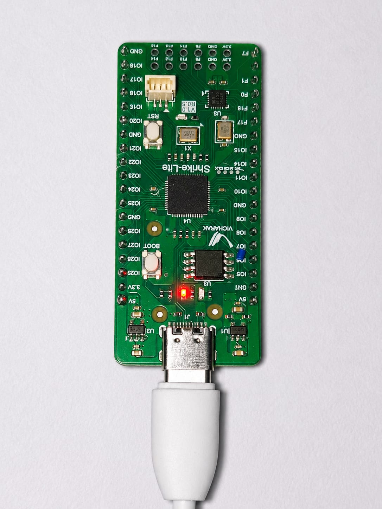
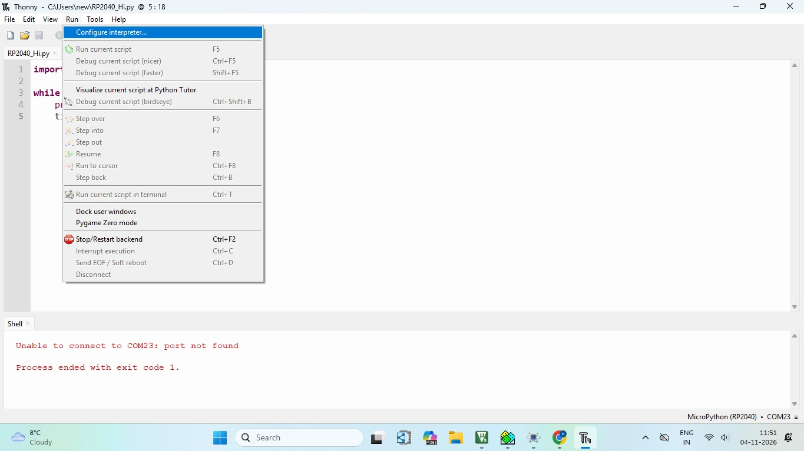
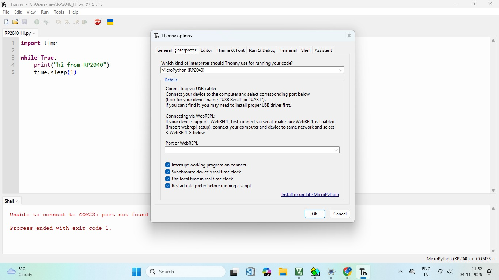
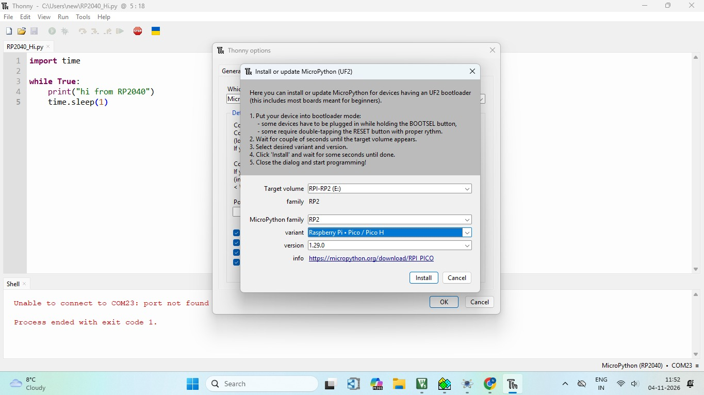
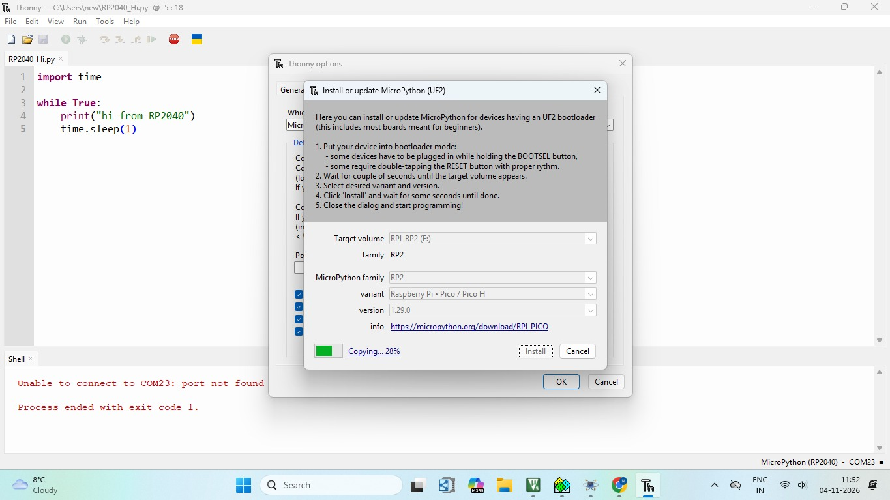
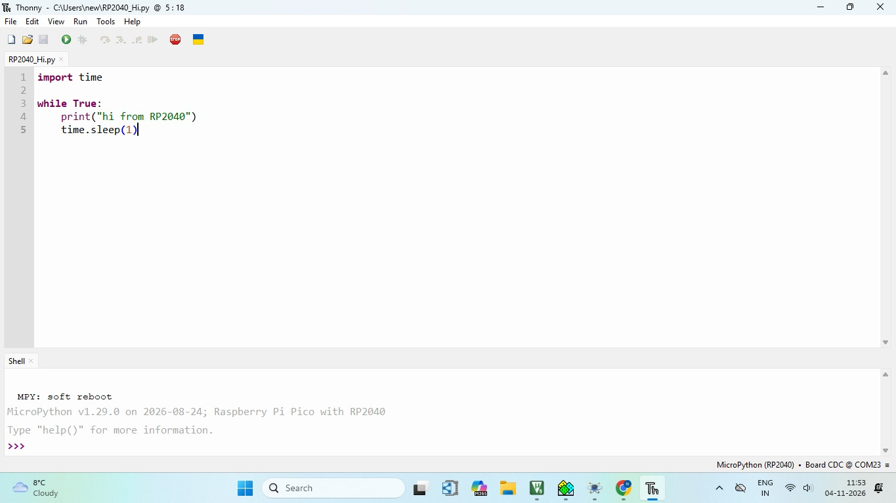
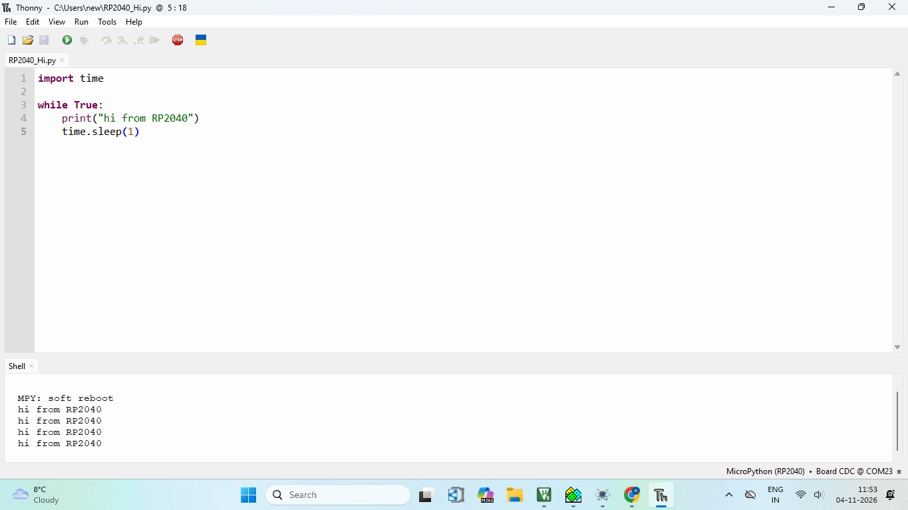

# RP2040 Hello World using MicroPython and Thonny


## Project Overview

This project is the first program on an RP2040 board using **MicroPython** and the **Thonny IDE**. It covers installing MicroPython firmware on the board through Thonny, then running a program that prints `hi from RP2040` on the Shell every second.

It confirms that the board, the USB connection, the MicroPython firmware and Thonny all work together before starting larger projects.

## Key Features

- MicroPython firmware installed directly from Thonny, no extra tools needed
- Step-by-step setup with screenshots of every window
- Simple program that prints a message every second
- Output viewed in the Thonny Shell

## Hardware Required

| Component | Quantity |
|-----------|----------|
| RP2040 board | 1 |
| USB Type-C cable (data cable) | 1 |
| Computer with Thonny installed | 1 |

### Hardware Setup

The board is connected to the computer with a USB Type-C cable, which provides both power and the serial connection.



## Code

The project has a single source file:

```
RP2040-Hi/
├── RP2040_Hi.py
├── Run_Configure_Interpreter.jpeg
├── Interpreter_Window.jpeg
├── Select_MicroPython_variant.jpeg
├── Install_MicroPython.jpeg
├── Stop_SoftReboot.jpeg
├── ShellWindow.jpeg
├── RP-2040.jpeg
└── README.md
```

### RP2040_Hi.py

```python
import time

while True:
    print("hi from RP2040")
    time.sleep(1)
```

## Setup Process

### Step 1: Open Configure Interpreter

In Thonny, go to **Run → Configure interpreter**.



### Step 2: Select the Interpreter

In the **Interpreter** tab, select **MicroPython (RP2040)** as the interpreter. Then click **Install or update MicroPython** at the bottom right of the window.



### Step 3: Select the MicroPython Variant

Put the board in bootloader mode as the Thonny dialog describes: hold the BOOT button while plugging in the USB cable. Wait a few seconds for the target volume to appear, then select:

| Setting | Value |
|---------|-------|
| Target volume | RPI-RP2 |
| MicroPython family | RP2 |
| Variant | Raspberry Pi • Pico / Pico H |
| Version | 1.29.0 |



### Step 4: Install MicroPython

Click **Install** and wait until the copying reaches 100%. Then close the dialog.



### Step 5: Check the Connection

After installation, the Shell shows the MicroPython version and the `>>>` prompt. The bottom right of Thonny shows **MicroPython (RP2040) • Board CDC @ COM23**, which means the board is connected.



### Step 6: Run the Program

Type the program in the editor, save it as `RP2040_Hi.py`, and click the green **Run** button.

## Output

The Shell prints `hi from RP2040` once every second:

```
MPY: soft reboot
hi from RP2040
hi from RP2040
hi from RP2040
hi from RP2040
```



## How It Works

1. `import time` loads the time module.
2. The `while True` loop runs forever.
3. `print("hi from RP2040")` sends the message to the Thonny Shell over USB.
4. `time.sleep(1)` waits one second before the next message.

```
Print message → Wait 1 second → repeat
```

## How to Run

1. Install **Thonny** on your computer.
2. Connect the RP2040 board with a USB data cable.
3. Follow the Setup Process above to install MicroPython (Steps 1 to 5).
4. Open `RP2040_Hi.py` in Thonny.
5. Click **Run**, or press **F5**.
6. Click **Stop** (or press **Ctrl+C**) in the Shell to end the program.

## Important Notes

### COM Port

The port number (COM23 here) can be different on your computer. Thonny shows it at the bottom right after the board connects.

### Port Not Found

If Thonny shows `Unable to connect to COM23: port not found`, MicroPython is not yet running on the board. Install it using the Setup Process above.

### USB Cable

Use a data-capable USB cable. Some cables only charge and the board will not appear on the computer.

## Technologies and Concepts

- RP2040
- MicroPython
- Thonny IDE
- UF2 bootloader
- USB serial (CDC) communication

## Future Improvements

- Blink an on-board or external LED
- Read an HC-SR04 ultrasonic sensor to measure distance
- Display values on an LCD
